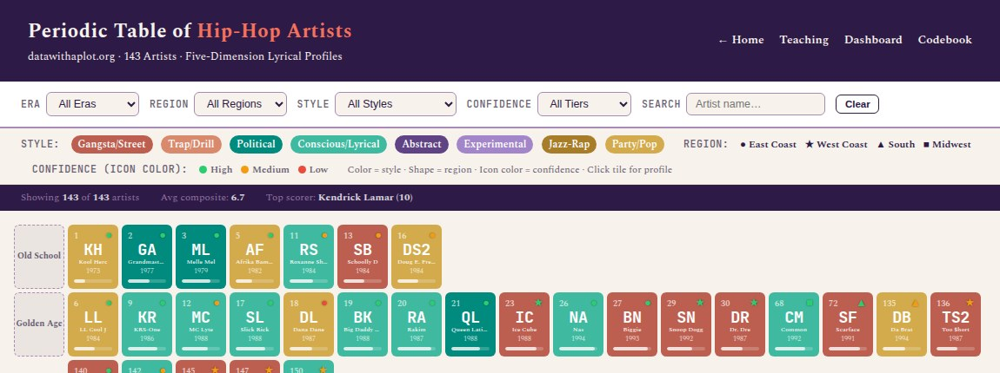
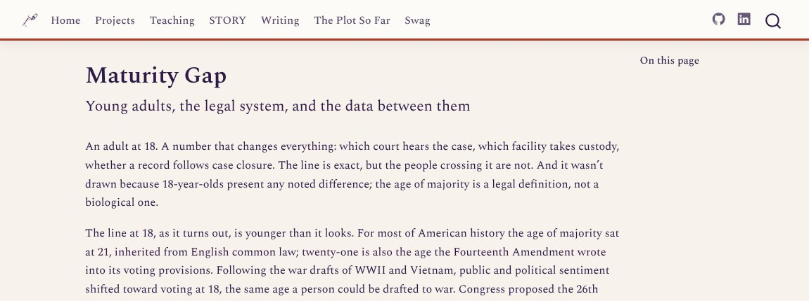

```{=html}
<div class="hero-section container">
  <div class="row align-items-center">
    <div class="col-md-9">
      <svg class="hero-logo" viewBox="0 0 470 110" xmlns="http://www.w3.org/2000/svg" role="img" aria-label="Data with a Plot · Lindsey E. Wylie, J.D., Ph.D.">
        <g transform="translate(5,5)">
          <g fill="none">
            <circle cx="18" cy="68" r="4" fill="#A98BB8"/>
            <circle cx="28" cy="84" r="4" fill="#A98BB8"/>
            <circle cx="32" cy="52" r="4" fill="#A98BB8"/>
            <circle cx="44" cy="26" r="4" fill="#A98BB8"/>
            <circle cx="52" cy="46" r="4" fill="#A98BB8"/>
            <circle cx="40" cy="42" r="4" fill="#B23A28"/>
            <path d="M10,80 C26,80 30,34 50,34 C58,34 58,42 62,46" stroke="#2E1A47" stroke-width="3.5" stroke-linecap="round"/>
            <g transform="translate(62,46) rotate(45)" stroke="#2E1A47" stroke-width="3" stroke-linecap="round" stroke-linejoin="round">
              <path d="M0,0 L-9,-20 Q0,-27 9,-20 Z"/>
              <line x1="0" y1="-4" x2="0" y2="-13"/>
              <circle cx="0" cy="-16.5" r="2.2"/>
              <rect x="-7.5" y="-44" width="15" height="22" rx="6"/>
            </g>
          </g>
        </g>
        <text x="120" y="72" font-family="Spectral,Georgia,serif" font-size="44" font-weight="600" fill="#2E1A47">Data <tspan font-style="italic" font-weight="400" fill="#B23A28">with a</tspan> Plot</text>
      </svg>
      <p class="hero-tagline">Lindsey E. Wylie, J.D., Ph.D.</p>
      <p class="hero-intro">
        Adult at 18. Senior at 65. High risk, moderate, or low. The law
        treats these bright lines like laws of nature. Every line misses the
        ones in between. I tell their stories with data.
      </p>
    </div>
  </div>
</div>
```

## The Premise {#about .section-heading data-eyebrow="01 · where this starts"}

```{=html}
<div class="bio-block">
  <span class="bio-avatar"></span>
  <div class="bio-body">
    <p>I am a researcher trained in law and psychology, and for more than
    twenty years I have studied how courts work and how they could work
    better for the people who come before them. That work has taken me from
    observing a mental health court in Brooklyn to linking statewide court
    records, and today, at the National Center for State Courts, I lead
    studies of pretrial court reminders and domestic violence court data and
    work on projects spanning young adults, treatment courts, competency, and
    guardianship. With Eve Brank, I wrote <em>Aging and the Criminal Legal
    System</em> (APA, 2025).</p>

    <div class="credential-badges">
      <span class="badge-item">Ph.D., Social Psychology · concentration in Research
      Design &amp; Data Analysis</span>
      <span class="badge-item">J.D. · concentration in Health Law</span>
    </div>

    <p>I built Data with a Plot to develop my skills in a place where I could
    publish directly to the web, and because I loved the name too much to let
    anyone else have it. It has become the place where I bring data to life
    in a way I could only imagine before: data stories that follow a finding
    from the numbers to the people behind them, teaching exercises that let
    you test your own judgment against the evidence, and planning tools that
    help colleagues choose an evaluation, a display, or a format for their
    own work.</p>

    <p>I build most of this with Claude Code, and I work with it the way I
    supervised research assistants and interns: with written instructions,
    clear direction, and my final edits. Like a strong graduate student,
    Claude Code does excellent work with sufficient preparation, but I hold
    the final judgments and products. The code behind every page is public,
    and so are the data wherever they can be shared, because I want my work
    to be shared, checked, and replicated.</p>

    <p><a class="bio-cta" href="selected-work/">See the plot so far: publications and CV →</a></p>
  </div>
</div>
```

```{=html}
<div class="section-divider" aria-hidden="true">
  <svg viewBox="0 0 220 34" aria-hidden="true" focusable="false">
    <path d="M8,27 C48,27 70,7 110,7 C150,7 178,24 212,26" fill="none" stroke="#2E1A47" stroke-width="3" stroke-linecap="round"/>
    <circle cx="30" cy="22" r="3.2" fill="#A98BB8"/>
    <circle cx="66" cy="14" r="3.2" fill="#A98BB8"/>
    <circle cx="104" cy="12" r="3.2" fill="#A98BB8"/>
    <circle cx="142" cy="16" r="3.2" fill="#A98BB8"/>
    <circle cx="186" cy="27" r="3.2" fill="#A98BB8"/>
    <circle cx="122" cy="4" r="3.6" fill="#B23A28"/>
  </svg>
</div>
```

## Start Here {#featured .section-heading data-eyebrow="02 · featured work"}

```{=html}
<div class="project-grid project-grid--pairs">
  <div class="project-card">
    <a href="hiphop/hiphop_periodic_table.html" class="project-card-thumb" aria-hidden="true" tabindex="-1">
      
    </a>
    <span class="project-card-tag">Data Storytelling</span>
    <p class="project-card-title"><a href="hiphop/hiphop_periodic_table.html">The Hip-Hop Periodic Table</a></p>
    <p class="project-card-desc">
      A dataset of  hip-hop acts, built to teach what goes into a score and
      what can quietly bend it, using a subject people genuinely argue about.
    </p>
  </div>

  <div class="project-card">
    <a href="countedwrong/index.html" class="project-card-thumb" aria-hidden="true" tabindex="-1">
      
    </a>
    <span class="project-card-tag">Data Storytelling</span>
    <p class="project-card-title"><a href="countedwrong/index.html">Maturity Gap: A Line at 18</a></p>
    <p class="project-card-desc">
      Young adults, the legal system, and the data between them: federal
      arrest, prison, and recidivism numbers, then a study that measured the
      same 1,354 people growing up, with a note under every figure on why
      that chart form got the job.
    </p>
  </div>
</div>
```

::: {style="text-align: center; padding: 3rem 0 1rem; color: #6A5F72; font-size: 0.9rem;"}
Built with [Quarto](https://quarto.org) · Hosted on [GitHub
Pages](https://pages.github.com)

<span style="display:block; margin-top:0.5rem; font-size:0.8rem; color:#6A5F72; font-style:italic;">n = 1 website. Results may not generalize.</span>
:::
