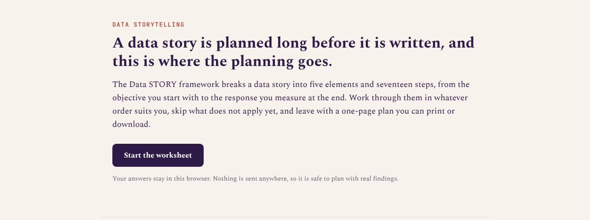
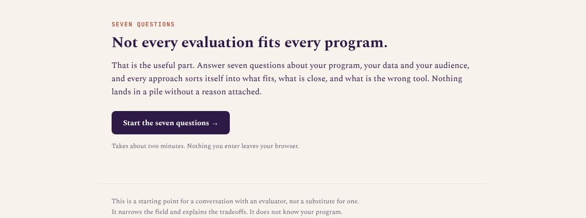
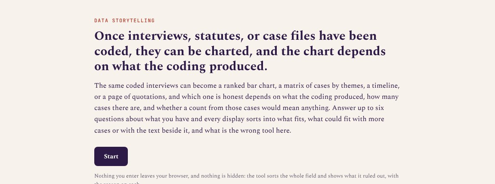

```{=html}
<style>
/* Page-scoped: the ink band that names the five STORY elements. Coral on ink
   is the brand's one allowed coral-as-text pairing (5.1:1); the glosses are
   the worksheet's own element intros, so the two cannot disagree. */
.story-band {
  background: #2E1A47;
  color: #F7F2EC;
  border-radius: 12px;
  padding: 2rem 1.75rem 1.75rem;
  margin: 0 0 2.75rem;
}
.story-band-eyebrow {
  font-family: "JetBrains Mono", monospace;
  font-size: 0.74rem;
  font-weight: 500;
  letter-spacing: 0.1em;
  text-transform: uppercase;
  color: #F4715C;
  margin: 0 0 1.25rem;
}
.story-band-grid {
  display: grid;
  grid-template-columns: repeat(5, minmax(0, 1fr));
  gap: 1.5rem 1.25rem;
}
@media (max-width: 900px) { .story-band-grid { grid-template-columns: repeat(2, minmax(0, 1fr)); } }
@media (max-width: 520px) { .story-band-grid { grid-template-columns: minmax(0, 1fr); } }
.story-el-letter {
  font-family: "JetBrains Mono", monospace;
  font-size: 2.1rem;
  font-weight: 500;
  line-height: 1;
  color: #F4715C;
}
.story-el-name {
  font-family: Spectral, Georgia, serif;
  font-weight: 600;
  font-size: 1.05rem;
  color: #FDFBF7;
  margin: 0.4rem 0 0.4rem;
}
.story-el-intro {
  font-size: 0.82rem;
  line-height: 1.55;
  color: rgba(247, 242, 236, 0.84);
  margin: 0;
}
.story-chapter {
  color: #6A5F72;
  font-size: 0.9rem;
  margin-top: 0.75rem;
}
</style>

<div class="page-header container">
  <p class="page-header-label">Planning tools</p>
  <h1 class="page-header-title">Data STORYtelling</h1>
  <p class="page-header-sub" style="font-style:italic;">
    Plan a court's data story from strategy to yield: a worksheet for the plan,
    and pickers for the evaluation behind it and the figures inside it.
  </p>
  <p class="story-chapter">
    The framework is from <a href="https://www.ncsc.org/sites/default/files/media/document/NCSC-Trends-2025.pdf"><em>Cultivating
    a Court's Data STORY</em></a>, Trends in State Courts, 2025. Presented at the
    National Association for Court Management.
  </p>
</div>

<div class="container">
  <section class="story-band" aria-labelledby="story-band-title">
    <p class="story-band-eyebrow" id="story-band-title">The five elements</p>
    <div class="story-band-grid">
      <div>
        <div class="story-el-letter" aria-hidden="true">S</div>
        <p class="story-el-name">Strategy</p>
        <p class="story-el-intro">Settle what the story is for, where it will live, who will tell it, and what falls inside its bounds, before any of it is written.</p>
      </div>
      <div>
        <div class="story-el-letter" aria-hidden="true">T</div>
        <p class="story-el-name">Target Audience</p>
        <p class="story-el-intro">Stories land with a narrow, well-defined audience rather than with "the public" or "policymakers," so name who you are speaking to and what they already know and care about.</p>
      </div>
      <div>
        <div class="story-el-letter" aria-hidden="true">O</div>
        <p class="story-el-name">Observations</p>
        <p class="story-el-intro">Let the data lead: state what they show, be open about where they came from and what could have bent them, and decide how much of the backstory this audience needs.</p>
      </div>
      <div>
        <div class="story-el-letter" aria-hidden="true">R</div>
        <p class="story-el-name">Representations</p>
        <p class="story-el-intro">Design the narrative and the illustration that carry the finding, with the people behind the data points, not the researcher, as the main characters.</p>
      </div>
      <div>
        <div class="story-el-letter" aria-hidden="true">Y</div>
        <p class="story-el-name">Yield</p>
        <p class="story-el-intro">Plan how the story goes out and how you will know whether it moved anyone to act, because insights alone are not the harvest.</p>
      </div>
    </div>
  </section>
</div>
```

## The Tools {#planning-tools .section-heading data-eyebrow="01 · planning tools"}

The worksheet holds the plan; the evaluation picker produces the findings a
story needs before it can be told, and the display picker serves the
Representations step.

```{=html}
<div class="project-grid container">
  <div class="project-card">
    <a href="../datastory/story_worksheet.html" class="project-card-thumb" aria-hidden="true" tabindex="-1">
      
    </a>
    <span class="project-card-tag">Planning Tool · Data Storytelling</span>
    <p class="project-card-title">The Data STORY Worksheet</p>
    <p class="project-card-desc">
      Seventeen fillable steps, strategy through yield, with a one-page plan to
      print or download at the end; it will not write the story for you, but it
      will show you which parts you have not thought through yet.
    </p>
    <a href="../datastory/story_worksheet.html" class="project-card-cta">
      Open the worksheet →
    </a>
    <p class="project-card-companion">
      Companion tool:
      <a href="../formatpicker/format_picker.html">format picker</a>
      (which deliverable fits)
    </p>
  </div>

  <div class="project-card">
    <a href="../evalpicker/eval_picker.html" class="project-card-thumb" aria-hidden="true" tabindex="-1">
      
    </a>
    <span class="project-card-tag">Planning Tool · Evaluation</span>
    <p class="project-card-title">Which Evaluation Should We&nbsp;Do?</p>
    <p class="project-card-desc">
      Answer up to seven questions about your program, and every evaluation
      approach sorts into what fits, what is ruled out, and what could fit with
      more time or data.
    </p>
    <a href="../evalpicker/eval_picker.html" class="project-card-cta">
      Open the evaluation picker →
    </a>
  </div>

  <div class="project-card">
    <a href="../qualpicker/qual_picker.html" class="project-card-thumb" aria-hidden="true" tabindex="-1">
      
    </a>
    <span class="project-card-tag">Planning Tool · Qualitative Data</span>
    <p class="project-card-title">Seeing Qualitative Data</p>
    <p class="project-card-desc">
      Answer up to six questions about what your coding produced and how many
      cases you have, and thirty-nine displays sort into what fits, what could
      fit with more, and what is the wrong tool here.
    </p>
    <a href="../qualpicker/qual_picker.html" class="project-card-cta">
      Open the display picker →
    </a>
  </div>
</div>
```
