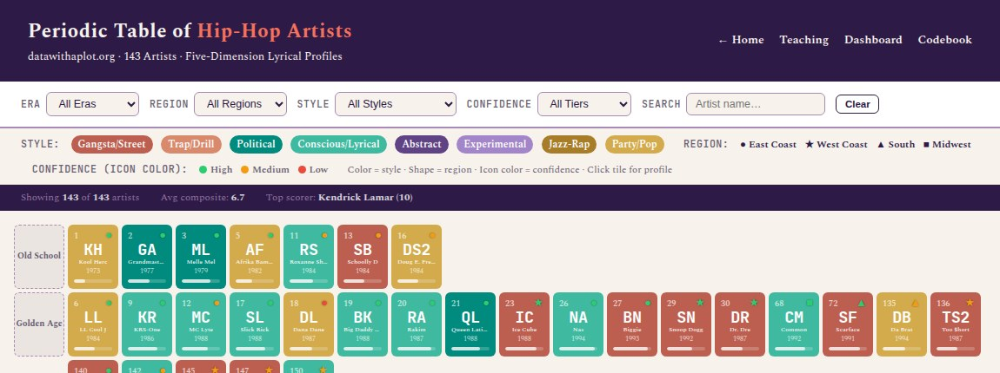
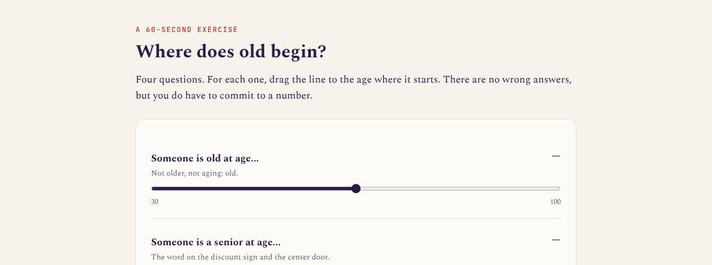
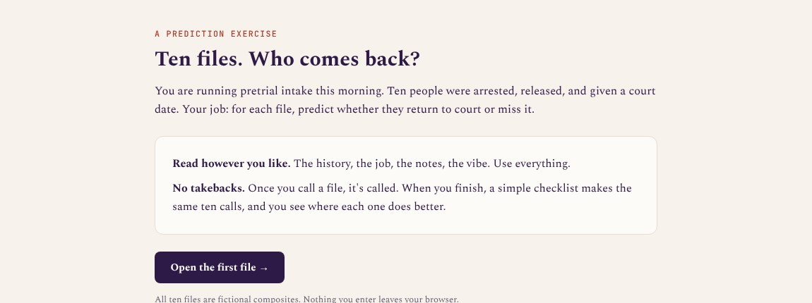

```{=html}
<div class="page-header container">
  <p class="page-header-label">Education</p>
  <h1 class="page-header-title">Teaching</h1>
  <p class="page-header-sub" style="font-style:italic;">
    Each exercise asks for a quick judgment and then shows what shaped it.
  </p>
  <p style="color:#6A5F72; font-size:0.9rem; margin-top:0.75rem;">
    More in <a href="https://www.ncsc.org/sites/default/files/media/document/NCSC-Trends-2025.pdf"><em>Cultivating
    a Court's Data STORY</em></a>, Trends in State Courts, 2025. Presented at the
    National Association for Court Management.
  </p>
</div>
```

## Warm-Ups {#short-exercises .section-heading data-eyebrow="01 · short exercises"}

Each starts with a quick call about something familiar, such as a favorite
rapper or the age at which someone becomes old, and then takes apart what went
into it.

```{=html}
<div class="project-grid container">

  <div class="project-card">
    <a href="../hiphop/hiphop_periodic_table.html" class="project-card-thumb" aria-hidden="true" tabindex="-1">
      
    </a>
    <span class="project-card-tag">Exercise · Measurement</span>
    <p class="project-card-title">The Hip-Hop Periodic Table</p>
    <p class="project-card-desc">
      Score a favorite rapper on gut feeling, then compare that score with a table
      of 187 hip-hop acts rated on five parts of lyricism, and see how much
      depends on what you decided to measure.
    </p>
    <a href="../hiphop/hiphop_periodic_table.html" class="project-card-cta">
      Explore the periodic table →
    </a>
  </div>


  <div class="project-card">
    <a href="../howold/how_old_is_old.html" class="project-card-thumb" aria-hidden="true" tabindex="-1">
      
    </a>
    <span class="project-card-tag">Exercise · Definitions</span>
    <p class="project-card-title">How Old Is Old?</p>
    <p class="project-card-desc">
      Set the age at which someone becomes old, a senior, or too old to drive,
      then see how far apart your own lines sit and where the law draws the same
      lines.
    </p>
    <a href="../howold/how_old_is_old.html" class="project-card-cta">
      Try How Old Is Old? →
    </a>
  </div>

  <div class="project-card">
    <a href="../gut/trust_your_gut.html" class="project-card-thumb" aria-hidden="true" tabindex="-1">
      
    </a>
    <span class="project-card-tag">Exercise · Prediction</span>
    <p class="project-card-title">Trust Your Gut?</p>
    <p class="project-card-desc">
      Read ten case files, predict who returns to court, and then see your calls
      scored against a checklist that uses exactly two facts.
    </p>
    <a href="../gut/trust_your_gut.html" class="project-card-cta">
      Trust your gut? →
    </a>
  </div>

</div>
```

```{=html}
<p class="container" style="color:#6A5F72; font-size:0.9rem; margin-top:0.25rem;">
  Also still live: <a href="../barnum/barnum_test.html" style="text-decoration:underline; text-underline-offset:2px;">The Barnum Test</a>,
  a short validity demonstration for the classroom.
</p>
```
